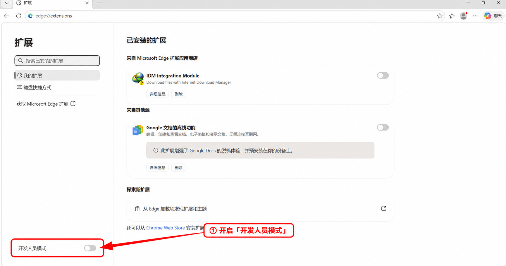
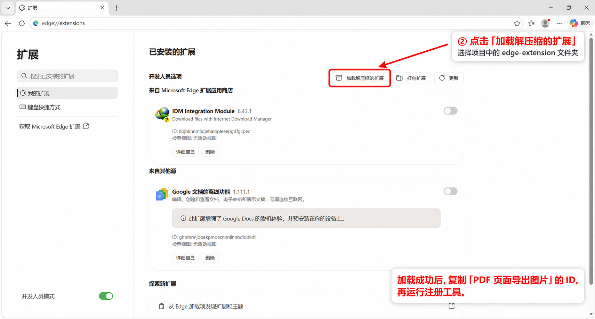
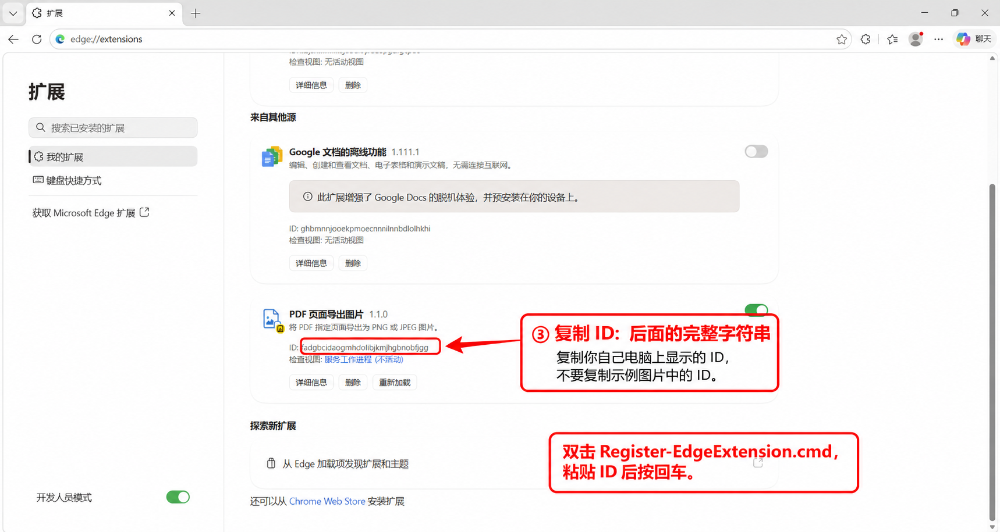

# PDF 页面导出图片

在 Edge 中将本地 PDF 的指定页面导出为 PNG 或 JPEG，保存到桌面。全部处理在本机完成。目前支持 Windows x64。

## 安装

仓库已包含 Windows x64 本地助手、运行依赖和 Poppler，无需安装 Python。点击 GitHub 页面上的 **Code → Download ZIP**，解压整个文件夹后按以下步骤安装。请勿只下载扩展文件夹。

### 1. 开启开发人员模式

在 Edge 地址栏输入 `edge://extensions`，打开左下角的**开发人员模式**。

### 2. 加载扩展

点击**加载解压缩的扩展**，选择项目中的 `edge-extension` 文件夹。

### 3. 复制 ID 并注册

找到 **PDF 页面导出图片** 扩展卡片，复制 `ID:` 后面的 **32 位小写字母**，不包含 `ID:` 或空格。请复制你自己电脑上显示的 ID，图片中的 ID 仅作示例。

双击项目中的 `Register-EdgeExtension.cmd`，粘贴刚复制的 ID，按回车，看到注册成功后关闭窗口。

最后，在本工具的**详细信息**中开启**允许访问文件 URL**，将扩展固定到工具栏，即可使用。

也可以在项目目录打开 PowerShell，运行 `./Register-EdgeExtension.ps1`，按提示输入 ID。移动整个工具目录后，需要重新注册。

## 使用

用 Edge 打开本地 PDF，点击扩展图标，输入页码并导出。

- `3-10`：导出第 3 到第 10 页。
- `1,3,5-8`：导出指定页面。
- 勾选**导出全部页面**，或输入 `1-`：确认后导出全部页面。

可以选择图片格式、清晰度及输出文件夹名称。未识别到本地 PDF 时，会弹出文件选择窗口。关闭扩展弹窗后，任务仍会继续；关闭浏览器可能中断任务。

## 修改与重新构建

普通使用无需构建。修改 `native-helper/PdfPageExportHost.py` 后，再重新打包：

1. 准备 Windows x64 Python（含 Tkinter），安装 PyInstaller：`py -m pip install pyinstaller`。
2. 在项目目录运行 `./Build-NativeHelper.ps1`，生成本地助手。exe 和 `_internal` 文件夹需一起保留。
3. 保留仓库自带的 `poppler/` 目录，程序会使用其中的 `poppler/poppler-26.02.0/Library/bin/`。
4. 按上方步骤安装扩展。

测试：`py -m unittest discover -s tests` 和 `node --test tests/extension.test.cjs`。Python 导出测试需要 Poppler。

日志位于 `%LOCALAPPDATA%\PDF-Page-Exporter\logs\native-host.log`，可能含文件路径，分享前请隐藏个人信息。

## 许可证

项目代码使用 [MIT 许可证](LICENSE)。第三方组件见 [第三方说明](THIRD-PARTY-NOTICES.md)。
